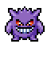
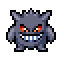
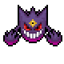
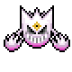
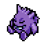
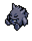
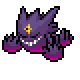
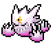
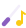

<div align="center">

# 👻 Herdr Gengars

**Una oficina virtual donde cada agente de Claude Code es un Gengar.**
Los roles trabajan en sus escritorios, descansan en el sillón y se ponen su accesorio.


<br>






<sub>trabajando</sub>






<sub>zZz... descansando en el sillón</sub>

</div>

---

## 💜 Qué es

Mi configuración de Herdr y Claude Code para ver a los agentes trabajar:

- 🖥️ **Oficina** (`gengar-office`): cada rol activo se sienta en un escritorio con el monitor encendido y usa un ataque según su rol ("Gengar Backend usó Puño Sombra").
- 🛋️ **Sillón**: los roles que no trabajan duermen ahí. El sillón crece con cada dos dormidos.
- 👥 **Panel Equipo** (`equipo-gengar`): una columna con los 13 roles. El que trabaja se despierta.
- 🎩 **Accesorios**: cada rol lleva el suyo (gorro, lupa, casco, escudo...) y el Orquestador una batuta.
- 🤖 **13 agentes** de Claude Code con sus instrucciones y dos ganchos que avisan a Herdr cuándo trabaja cada uno.

## ⚙️ Cómo funciona

```
Claude Code lanza un agente
        │  (hook PreToolUse / SubagentStop)
        ▼
equipo-estado.js  ──►  ~/.config/herdr-app/data/equipo-gengar/estado.json
                                   │  lo lee cada 0,7 s
                  ┌────────────────┴────────────────┐
                  ▼                                 ▼
          panel "Equipo"                      oficina (escritorios)
```

## 🎭 Los roles

| Rol | Accesorio | Dónde | Skin |
|---|:---:|---|---|
| Analista de negocios |  gráfico | costado | shiny |
| Innovación |  bombilla | cabeza | mega |
| PM |  portapapeles | costado | normal |
| UI/UX |  boina | cabeza | mega shiny |
| Arquitecto |  birrete | cabeza | mega |
| DBA |  base de datos | costado | mega shiny |
| Backend |  casco | cabeza | normal |
| Frontend |  código | costado | shiny |
| QA |  gafas | cara | normal |
| Seguridad |  escudo | costado | mega shiny |
| Líder técnico |  corona | cabeza | shiny |
| Documentador |  cuaderno | costado | shiny |
| DevOps |  cohete | costado | mega |
| Orquestador |  batuta | costado | la de su terminal |

## 📦 Qué hay en el repositorio

```
claude/
├── CLAUDE.md          preferencias (agentes en paralelo y en conjunto)
├── settings.json      hooks de Claude Code
├── agents/            los 13 roles
└── hooks/             equipo-estado.js · nombrar-orquestador.js
herdr/
├── mods/gengar-office/   la oficina
├── mods/equipo-gengar/   el panel Equipo
├── layouts/main-gengar.json
└── themes/               gengar · gengar-shiny · gengar-mega
docs/sprites/             GIFs de este README
```

## 🚀 Instalación

Necesitas Herdr, [Claude Code](https://claude.com/claude-code), `curl` e [ImageMagick](https://imagemagick.org) (`magick`).

1. Clona el repositorio:
   ```bash
   git clone https://github.com/TU_USUARIO/herdr-gengars.git
   ```
2. Copia las carpetas:
   - `herdr/*` → `~/.config/herdr-app/`
   - `claude/agents`, `claude/hooks` y `claude/CLAUDE.md` → `~/.claude/`
3. **Ajusta `settings.json`.** Los ganchos apuntan a `C:/Users/smaldonado/.claude/hooks/...`: cambia esa ruta por la de tu usuario. Si ya tienes un `settings.json`, fusiona solo el bloque `hooks` en vez de sobrescribirlo.
4. Comprueba que el mod carga:
   ```bash
   herdr-app check mods/gengar-office
   ```
5. Abre Herdr y cambia al layout `main-gengar`.

La primera vez, la oficina descarga los sprites y los corta con ImageMagick. Si ves el aviso "Install ImageMagick", instálalo y reinicia Herdr.

## 🙏 Créditos

- Sprites de Gengar: [PMDCollab SpriteCollab](https://github.com/PMDCollab/SpriteCollab) (`sprite/0094`), arte hecho por fans. Los GIFs de `docs/` son recortes de esas hojas.
- Pokémon y Gengar son marcas de Nintendo, Game Freak y Creatures Inc. Este es un proyecto personal de fans, sin relación con ellos ni con Herdr.
- Si haces público este repositorio, revisa antes la licencia de PMDCollab para los sprites de `docs/`.

<div align="center">

<sub>👻 hecho con mucho cariño y un poco de maldición</sub>

</div>
